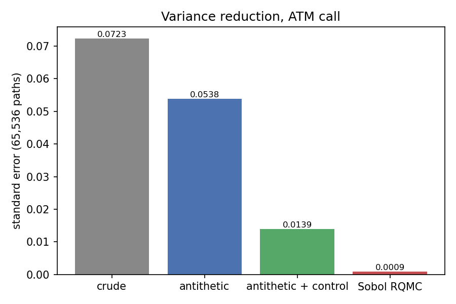
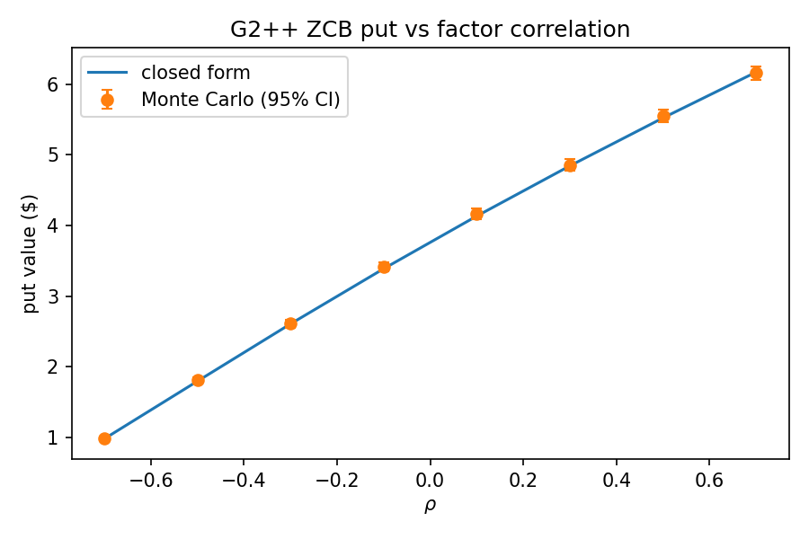
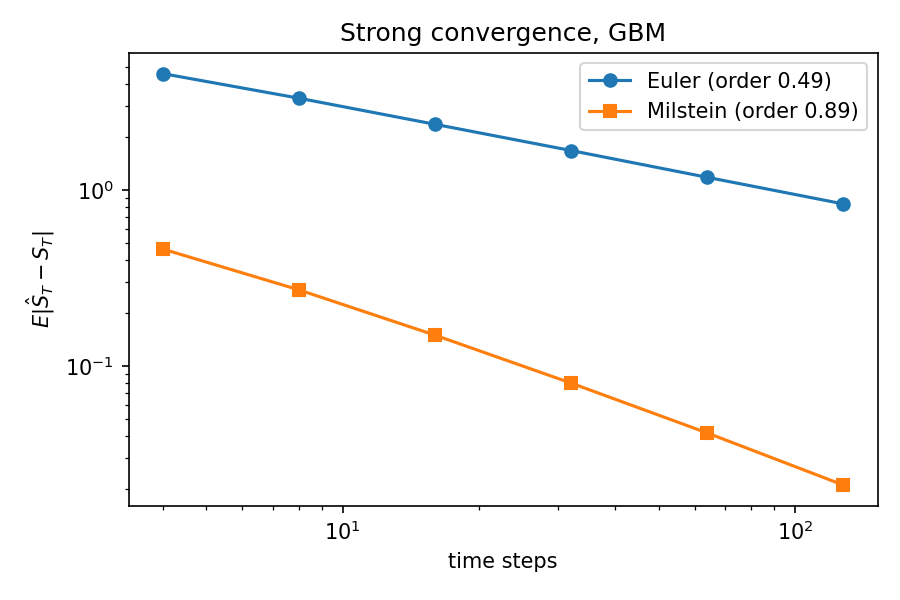
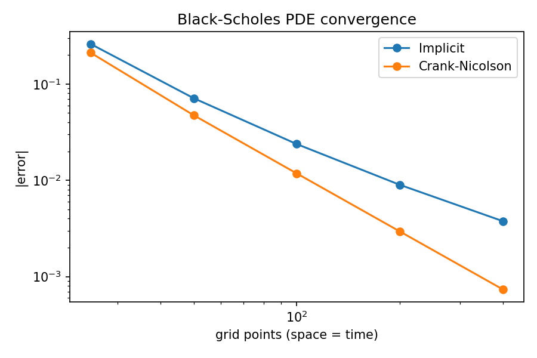

# Derivatives Pricing & Term-Structure Model Library

[](https://github.com/Khush-Paliwal/derivatives-pricing-library/actions/workflows/ci.yml)


*Advanced Computational Methods, UCLA Anderson MFE, 2026*

A from-scratch Python library for pricing equity and interest-rate derivatives three independent ways
(**Monte Carlo**, **closed form / Fourier**, and **finite-difference PDE**) and cross-checking every
simulated price against an exact benchmark.

| Area | What's implemented |
|---|---|
| **Monte Carlo engine** | European and path-dependent payoffs (Asian, barrier incl. time-dependent, lookback, digital); antithetic variates, control variates, randomised quasi-MC (scrambled Sobol), Halton sequences; standard errors and confidence intervals on every price |
| **Equity models** | Black-Scholes (exact / Euler / Milstein), **Merton jump-diffusion** (exact timeline simulation), **Heston stochastic volatility** (full / partial truncation and reflection schemes) |
| **Fourier pricing** | Characteristic functions for BS, Merton and Heston (Albrecher "little trap"); Gil-Pelaez quadrature and Carr-Madan FFT |
| **American options** | Longstaff-Schwartz LSMC (Laguerre / Hermite / monomial bases, 2-factor Heston regression), CRR binomial benchmark, PDE with early-exercise projection |
| **Greeks** | Analytic BS Greeks; Monte Carlo bump-and-revalue with common random numbers, pathwise and likelihood-ratio estimators |
| **PDE solvers** | One θ-scheme (explicit / implicit / Crank-Nicolson with Rannacher smoothing) for any 1-D parabolic PDE; Black-Scholes in S and ln S; CIR bond and bond-option PDEs |
| **Short-rate models** | **CIR** (closed-form bonds, noncentral-χ² bond options, exact and full-truncation simulation, Jamshidian coupon-bond options) and **G2++** (Brigo-Mercurio closed forms, exact bivariate-OU simulation), plus caps/floors |

## Every Monte Carlo price is checked against an exact answer

`derivpricing-validate` regenerates [`reports/VALIDATION.md`](reports/VALIDATION.md): **22 / 22 checks pass**
(Monte Carlo within 3 standard errors, deterministic methods within tolerance). A selection:

| Model | Instrument | Monte Carlo (± s.e.) | Reference | Reference method |
|---|---|---|---|---|
| Black-Scholes | ATM call | 12.3364 ± 0.0005 (Sobol RQMC) | 12.3360 | closed form |
| Heston (Feller violated) | ATM call | 10.162 ± 0.016 | 10.155 | characteristic function |
| Merton jump-diffusion | ATM call | 12.971 ± 0.024 | 12.948 | Poisson-weighted BS series |
| Black-Scholes | down-and-out put, 250 dates | 1.2679 ± 0.0071 | 1.2705 | closed form + BGK continuity correction |
| Black-Scholes | American put | 2.3052 (LSMC), 2.3186 (CN PDE) | 2.3194 | 2,000-step CRR tree |
| CIR | ZCB call, K = 980 | 0.3913 ± 0.0026 (MC), 0.3940 (implicit PDE) | 0.3941 | noncentral χ² |
| CIR | 4-year coupon bond | 1021.11 ± 0.19 | 1021.14 | sum of affine ZCBs |
| G2++ | ZCB put, ρ = 0.7 | 6.205 ± 0.019 | 6.172 | Brigo-Mercurio closed form |

<p align="center">
  
  
  
  
</p>

Measured convergence matches theory: MC error ∝ N^-0.53, Halton QMC ∝ N^-0.92, Euler strong order 0.49,
Milstein 0.89, Crank-Nicolson second order. On the same 65,536 paths, standard errors are
0.072 (crude) → 0.054 (antithetic) → 0.014 (+ control variate) → 0.0009 (Sobol RQMC), a ~80× reduction.

## Quick start

```bash
git clone https://github.com/Khush-Paliwal/derivatives-pricing-library.git
cd derivatives-pricing-library
pip install -e ".[dev]"
pytest                      # 47 tests, ~20 s
derivpricing-validate       # rebuild reports/VALIDATION.md and figures
```

```python
from derivpricing.models import Heston, MertonJD
from derivpricing import monte_carlo as mc, payoffs as po
from derivpricing.rates import CIR, G2pp
from derivpricing.pde import bs_fd, zcb_option_pde

# Heston: Monte Carlo vs Fourier
h = Heston(S0=100, v0=0.04, r=0.05, kappa=2.0, theta=0.04, xi=0.5, rho=-0.7)
mc.price(h, po.European(100), T=1.0, n_paths=200_000, n_steps=200)   # MCResult(price=10.16, stderr=0.016, ...)
h.european_price(100, 1.0)                                           # 10.1546

# Path-dependent payoff under jumps, with antithetics
m = MertonJD(S0=100, r=0.05, sigma=0.2, lam=0.75, mu_j=-0.1, sigma_j=0.2)
mc.price(m, po.Barrier(K=100, barrier=80, kind="put", direction="down", knock="out"), T=1.0, n_steps=252)

# CIR bond option three ways
c = CIR(r0=0.05, kappa=0.92, theta=0.055, sigma=0.12)
c.zcb_option(0.5, 1.0, K=980, kind="call", face=1000)        # noncentral chi-square: 0.3941
c.mc_zcb_option(0.5, 1.0, K=980, kind="call", face=1000)     # Monte Carlo
zcb_option_pde(c, 0.5, 1.0, K=980, kind="call", face=1000)   # implicit finite differences

# G2++ two-factor model
G2pp(a=0.1, b=0.3, sigma=0.05, eta=0.09, rho=0.7, phi=0.055).zcb_option(0.5, 1.0, 950, "put", face=1000)  # 6.1716
```

A guided tour with plots is in [`examples/tour.ipynb`](examples/tour.ipynb).

## Design

```
src/derivpricing/
├── stats.py           MCResult (price, stderr, CI), control-variate estimator, path-count sizing
├── analytic/          Black-Scholes + Greeks + implied vol, exotic closed forms, Fourier pricing
├── models/            GBM, Heston, MertonJD (+ generic Euler / Milstein schemes)
├── monte_carlo.py     engine: antithetic, control variates, Sobol RQMC, common random numbers
├── payoffs.py         European, Digital, Asian, Barrier, Lookback (operate on simulated paths)
├── qmc.py             van der Corput, Halton, scrambled Sobol
├── greeks.py          bump-and-revalue (CRN), pathwise, likelihood-ratio
├── american.py        Longstaff-Schwartz LSMC, CRR binomial
├── pde/               generic theta-scheme, Black-Scholes and CIR PDEs
├── rates/             CIR, G2++, caps / floors / swap rates
└── validation.py      MC vs closed form vs PDE report
```

Two choices keep the code small and the results trustworthy:

* **The engine owns the randomness.** Models receive their standard normals from the engine, so antithetic
  pairing, quasi-random sampling and common random numbers for Greeks are written once and work for every model.
* **One PDE solver.** Every pricing PDE here is V_τ = a(y) V_yy + b(y) V_y + c(y) V, so explicit, implicit and
  Crank-Nicolson differ only in θ, and Black-Scholes (in S or ln S) and CIR (bond and bond option) are thin
  wrappers that supply coefficients and boundary conditions.

## Findings worth knowing

* **Heston discretisation matters.** With the Feller condition violated (2κθ < ξ²), the *reflection* scheme is
  biased by ≈ 0.44 on a 10-dollar option while *full truncation* is unbiased (tested), matching
  Lord, Koekkoek & van Dijk (2010).
* **Discrete vs continuous monitoring.** A barrier checked on 250 dates knocks out less often than the
  continuous closed form assumes; the Broadie-Glasserman-Kou shift H·e^{∓0.5826 σ √Δt} reconciles them.
* **LSMC is low-biased**, and rises toward the binomial value as the basis grows (2.291 → 2.305 vs 2.319).
* **Gaussian rates can go negative**: a zero-strike G2++ caplet is worth slightly *more* than the floating leg,
  because P(T, T+δ) > 1 on some paths, whereas under CIR the two are equal (both tested).

## References

Glasserman, *Monte Carlo Methods in Financial Engineering* (2003) · Brigo & Mercurio, *Interest Rate Models:
Theory and Practice* (2006) · Heston (1993) · Merton (1976) · Cox, Ingersoll & Ross (1985) ·
Longstaff & Schwartz (2001) · Carr & Madan (1999) · Albrecher, Mayer, Schoutens & Tistaert (2007) ·
Lord, Koekkoek & van Dijk (2010) · Broadie, Glasserman & Kou (1997) · Jamshidian (1989)

## Author

Khush Paliwal, UCLA Anderson MFE. MIT licence.
